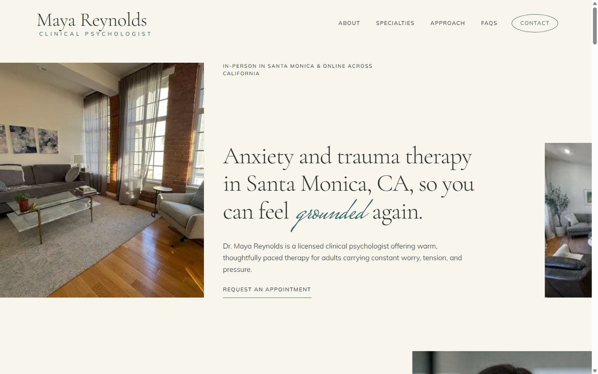
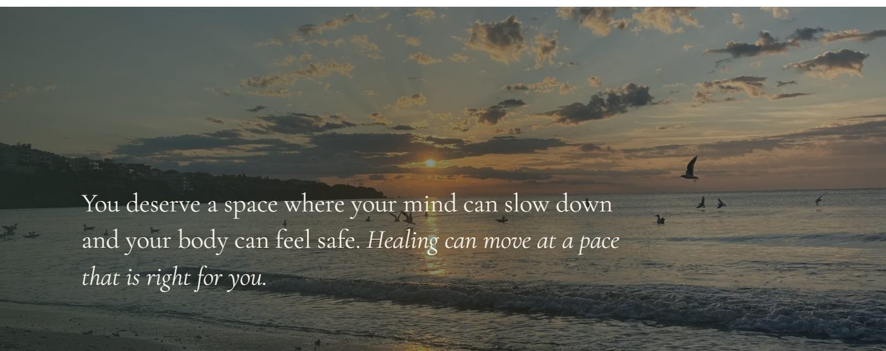
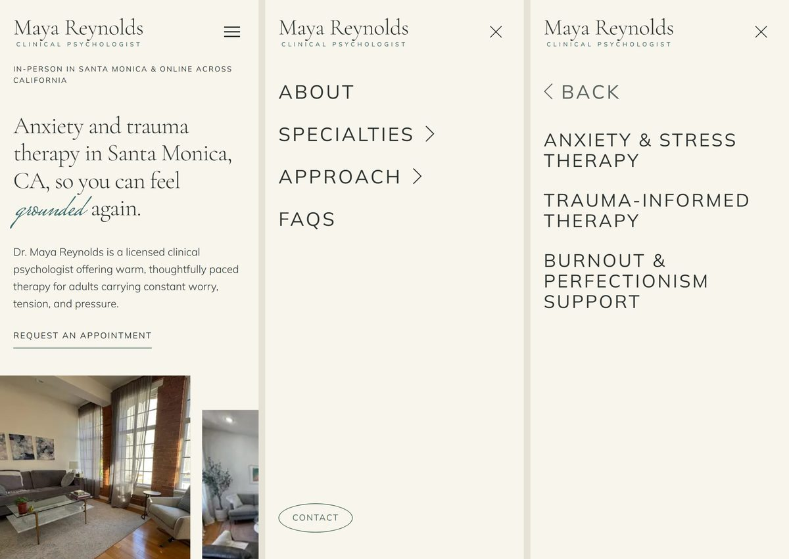
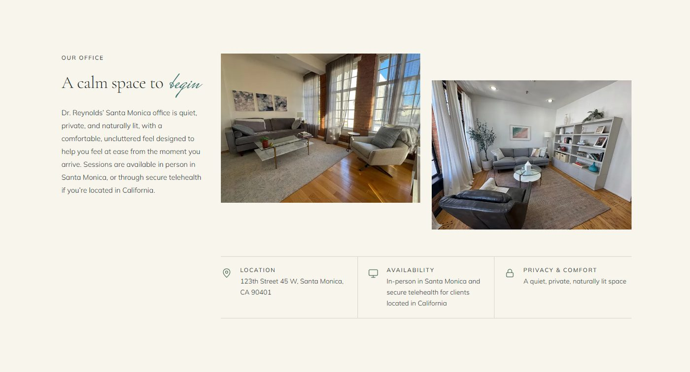
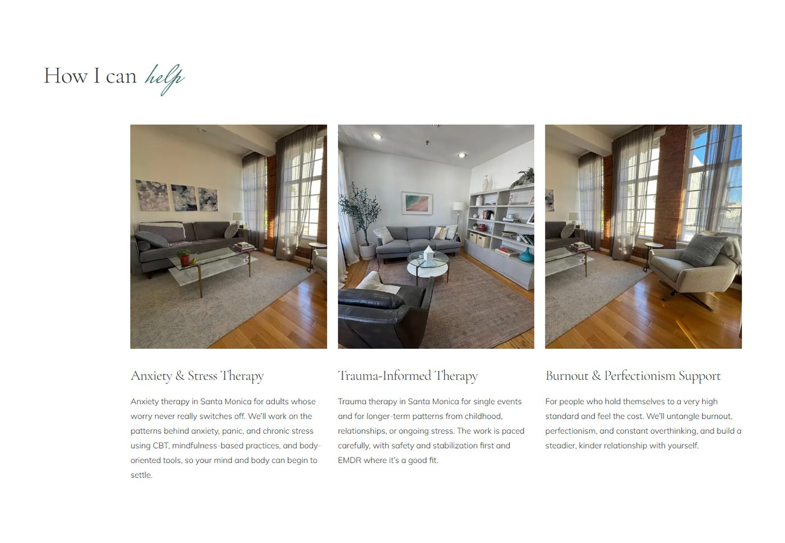

# Dr. Maya Reynolds, PsyD: Therapy Practice Website

A fast, responsive, accessible one-page website for a therapist in Santa Monica, CA, built with **Next.js 16 (App Router)**, **Tailwind CSS v4** and **TypeScript**.

**Live site:** https://grow-my-therapy-tan-tau.vercel.app/

> Dr. Maya Reynolds is a **fictional** licensed clinical psychologist. This project was built for the Grow My Therapy front-end internship assignment: clone a reference therapy homepage, redesign it around a therapist profile, and add a custom "Our Office" section.



---

## Contents

- [What's inside](#whats-inside)
- [Tech stack](#tech-stack)
- [Getting started](#getting-started)
- [Project structure](#project-structure)
- [Customizing the site](#customizing-the-site)
  - [Change the colors (theme)](#change-the-colors-theme)
  - [Change the fonts](#change-the-fonts)
  - [Change the content and images](#change-the-content-and-images)
  - [Add or reorder sections](#add-or-reorder-sections)
- [Using this for a new therapy practice](#using-this-for-a-new-therapy-practice)
- [Accessibility and performance](#accessibility-and-performance)
- [Quality checks](#quality-checks)
- [Known placeholders](#known-placeholders)
- [Documentation and credits](#documentation-and-credits)

---

## What's inside

The home page runs through these sections, in order (each has an anchor id used by the navigation):

| # | Section | Anchor | Purpose |
|---|---|---|---|
| 1 | Hero | `#hero` | Location-specific H1, eyebrow, call to action, two-photo collage |
| 2 | About | `#about` | Dr. Reynolds' bio with portrait |
| 3 | How I can help | `#specialties` | Three services: anxiety and stress, trauma-informed, burnout and perfectionism |
| 4 | Quote banner | `#quote` | Full-bleed coastal photo with an overlay and a reassuring quote |
| 5 | Areas of focus | `#areas-of-expertise` | Two-column list of concerns she supports |
| 6 | My approach | `#how-we-work` | Her style: collaborative, structured, paced with care |
| 7 | Statement | `#statement` | Office photo with a short statement |
| 8 | Approaches | `#approach` | CBT, EMDR, mindfulness-based practices, body-oriented techniques |
| 9 | **Our Office** | `#our-office` | The custom section: real office photos plus location, availability and privacy details |
| 10 | FAQs | `#faqs` | Accessible accordion, with FAQ structured data for search engines |
| 11 | Schedule | `#schedule` | Closing call to action |
| 12 | Footer | `#contact` | Address, navigation, specialties, legal bar |

**Highlights**

- Desktop navigation with hover dropdowns and an elliptical **Contact** button.
- **Mobile menu** that slides between two panels: the main list, and a sub-menu with a **Back** control. It is not an inline accordion.
- Animated text-link underline: it retracts on hover and regrows on leave.
- Accent "script" words in headings (for example *grounded*, *begin*) rendered from simple markup in the content file.
- Local SEO: a location-specific title, description and H1, plus `FAQPage` JSON-LD.

| Desktop | Mobile |
|---|---|
|  |  |
|  |  |

---

## Tech stack

| Area | Choice |
|---|---|
| Framework | Next.js **16.4** (App Router, Turbopack), React 19 |
| Styling | Tailwind CSS **v4** with role-based CSS variables |
| Language | TypeScript |
| Fonts | `next/font/google`: Cormorant Garamond (headings), Mulish (body), Mrs Saint Delafield (script accents) |
| Images | `next/image` (responsive sizes, lazy loading, no layout shift) |
| Hosting | Vercel |

No UI component libraries or other runtime dependencies beyond Next.js and React.

---

## Getting started

**Requirements:** Node.js **20.9 or newer** and npm.

```bash
git clone https://github.com/FaheemNazir1/grow-my-therapy.git
cd grow-my-therapy
npm install
npm run dev
```

Open http://localhost:3000. The page hot-reloads as you edit.

| Command | What it does |
|---|---|
| `npm run dev` | Start the development server |
| `npm run build` | Create the production build |
| `npm start` | Serve the production build |
| `npm run lint` | Run ESLint |
| `npx tsc --noEmit` | Type-check the project |

> **Tip:** Don't run `npm run build` while `npm run dev` is running in the same folder. Both write to `.next` and can leave the dev server with a stale cache. Stop the dev server first, or delete `.next` afterwards.

> **Next.js 16 note:** This version has changes from earlier releases. See [AGENTS.md](AGENTS.md), and consult `node_modules/next/dist/docs/` before changing framework-level behavior.

---

## Project structure

```
app/
  layout.tsx          Fonts, page metadata, skip link
  page.tsx            Home page: sections in order
  globals.css         Theme tokens (colors) and base styles
components/
  sections/           One file per home page section (Hero, Faq, OurOffice, Footer, ...)
  ui/                 Reusable building blocks (Button, Section, Container, Logo, ScriptText, ...)
content/
  site.ts             ALL copy, links and image slots, fully typed
public/images/
  maya/               Portrait and office photos supplied with the assignment
  coast/              Quote banner photo (CC0)
docs/                 Project notes, specs, image credits and screenshots
tailwind.config.ts    Maps color and font tokens to Tailwind utilities
next.config.ts        Next.js settings
```

**Design rule:** Components never hard-code copy or colors. Text lives in `content/site.ts`, and colors come only from the theme variables.

---

## Customizing the site

### Change the colors (theme)

All colors are defined once, as CSS variables at the top of [`app/globals.css`](app/globals.css). Edit those values and the whole site restyles: buttons, backgrounds, borders, links, focus rings, the quote overlay and the footer.

| Token | Current value | Used for |
|---|---|---|
| `--color-ink` | `#2D3330` | Body text (charcoal) |
| `--color-muted` | `#5B645E` | Secondary text |
| `--color-bg` | `#F8F5EC` | Page background (warm ivory) |
| `--color-surface` | `#FFFFFF` | White content sections |
| `--color-border` | `#D3D8CB` | Dividers and outlines |
| `--color-primary` | `#4D6D59` | Buttons, underlines, focus ring (muted sage) |
| `--color-secondary` | `#ECE6D5` | Cream section background |
| `--color-accent` | `#3A6E6C` | Script words, tagline, footer bar (dusty teal) |
| `--color-dark` | `#27322C` | Quote banner overlay |
| `--color-on-dark` | `#F8F5EC` | Text on dark and accent surfaces |

Body text uses `ink` and never `primary`, so a new brand color can't affect readability. When you pick new colors, keep **at least 4.5:1** contrast for text (for example `ink` on `bg`, and `on-dark` on `accent`).

### Change the fonts

Fonts are set in [`app/layout.tsx`](app/layout.tsx). Swap the `next/font/google` imports but keep the variable names (`--font-heading`, `--font-body`, `--font-script`) and everything else follows.

### Change the content and images

Everything visible is in [`content/site.ts`](content/site.ts): navigation, every section's copy, FAQs, footer and SEO metadata.

Two small markers work inside strings:

| Write | Result |
|---|---|
| `"...begin to *thrive*."` | `thrive` is shown in the accent script font |
| `"..._this part is italic._"` | the phrase is shown in italics |

**Images:** Put files in `public/images/`, then update the image slot in `content/site.ts` (`src`, `alt`, `width`, `height`). Use `objectPosition` (for example `"50% 20%"`) to control how a photo is cropped in each slot, so one photo can be reused with different crops. Always write a meaningful `alt` text.

**Contact details:** `footer.contact.email` and `footer.contact.phone` are optional. Add either one and it appears in the footer as a clickable link. Leave it out and nothing is shown.

### Add or reorder sections

1. Add the section's data and types to `content/site.ts`.
2. Create a component in `components/sections/`, reusing `Section`, `Container`, `SectionHeading`, `Eyebrow` and `Button`.
3. Render it in `app/page.tsx` where you want it.

---

## Using this for a new therapy practice

1. **Content:** Replace the copy in `content/site.ts` with the new therapist's profile. Keep claims to what the profile states.
2. **Images:** Add their photos to `public/images/` and update the slots.
3. **Brand colors and fonts:** Edit the variables in `app/globals.css` and the fonts in `app/layout.tsx`.
4. **Name and logo:** Update `navigation.wordmark` (the logo is a text wordmark, so no image file is needed).
5. **SEO:** Update `meta.title`, `meta.description`, the hero H1 and the footer address with the new city and specialties.
6. **Check:** Run `npm run lint`, `npx tsc --noEmit` and `npm run build`, then view the site at about 390, 768 and 1440 pixels wide.

---

## Accessibility and performance

- **Contrast:** All text and background pairs in the theme are at least 4.5:1.
- **Keyboard:** Visible focus rings, a "Skip to content" link, and keyboard-operable menus and FAQ.
- **Mobile menu:** The off-screen panel is `inert` and `aria-hidden`, focus is trapped while the menu is open, and Escape closes it. Page scroll is locked behind it.
- **FAQ:** Built on native `<details>` and `<summary>` elements.
- **Reduced motion:** Slide and underline transitions are disabled for users who prefer less motion.
- **Images:** `next/image` serves correctly sized files, with explicit dimensions to avoid layout shift. All images have descriptive alt text.
- **Semantic HTML:** One H1 per page and an ordered heading hierarchy.
- **Rendering:** The home page is statically generated.

---

## Quality checks

The following were run against a clean production build:

- `npm run lint`: passes with no warnings or errors
- `npx tsc --noEmit`: passes
- `npm run build`: passes
- Layouts checked at **390, 768 and 1440 px** wide: no horizontal overflow, no broken images
- No console or network errors in the production build

---

## Known placeholders

- **Phone and email:** Not provided in the profile, so they are intentionally omitted. See [Change the content and images](#change-the-content-and-images) for how to add them.
- **Legal links:** Terms, Privacy Policy and Disclaimer currently link to `#`. Add real pages before launch.
- **Address:** `123th Street 45 W, Santa Monica, CA 90401` is used exactly as supplied in the profile.
- **Photos:** Only two office photos and one portrait were supplied, so some are reused with different crops.

---

## Documentation and credits

The [`docs/`](docs) folder holds project notes:

- [`maya-profile.md`](docs/maya-profile.md): the therapist profile facts used as the single source of truth for copy
- [`image-credits.md`](docs/image-credits.md): sources and licenses for every image
- `reference-spec.md`, `reference-*.png`, `clone-check/`: measurements and screenshots from the original **cloning phase** (they describe the reference site's original palette, not the current theme)

**Credits**

- Portrait and office photos: supplied with the assignment materials.
- Quote banner photo: *A serene beach scene at sunset* by Nick Krastev, from the [WordPress Photo Directory](https://wordpress.org/photos/photo/49563db010/), released under CC0.
- Layout reference: [conejovalleycounseling.com](https://www.conejovalleycounseling.com/home) was studied for layout and interaction only. None of its copy, branding or imagery is used.
